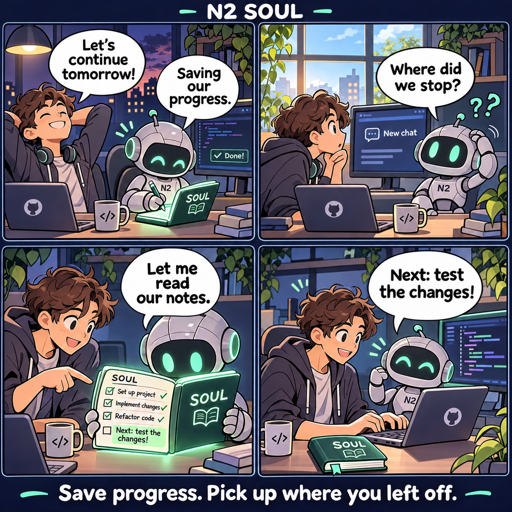
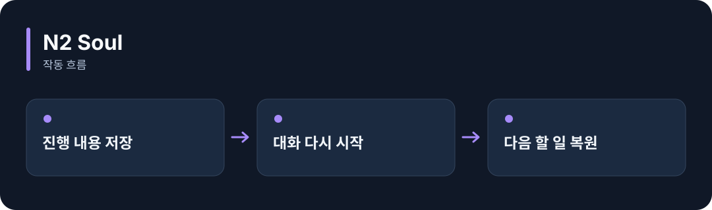

# N2 Soul

**AI와 진행한 일과 다음 할 일을 저장해, 다음 대화에서 이어갈 수 있게 도와줍니다.**

[](https://github.com/choihyunsus/soul/releases/tag/v9.2.1) [](https://github.com/choihyunsus/soul/blob/main/docs/reference.ko.md) [](https://github.com/choihyunsus/soul/blob/main/LICENSE)

[English](README.md)

<p align="center">
  
</p>

어제 작업을 저장하고 → 새 대화에서 메모를 읽어 → 다음 할 일을 확인하고 → 작업을 이어갑니다.

기능을 이야기로 표현한 만화입니다. 실제 앱 화면은 아닙니다.

<details>
<summary>동작 흐름 펼쳐 보기</summary>



</details>

## 이런 때 사용하세요

긴 작업을 며칠에 걸쳐 이어가거나, 대화가 바뀔 때마다 배경을 다시 설명해야 할 때 사용하세요.

사용하는 AI 앱에 MCP 연결 기능이 필요합니다. MCP는 AI 앱이 외부 도구를 호출하는 연결 방식입니다. 저장·복원 도구를 실제로 호출하도록 앱이나 에이전트에 설정해야 합니다.

## 처음 실행하기

터미널에서 `node --version`을 실행해 Node.js 22 이상인지 확인하세요. 아래 명령은 새 연습 폴더를 만들고 GitHub 배포 파일을 설치합니다. 예제 파일과 DB도 이 폴더에 두면 경로를 따라가기 쉽습니다.

```sh
mkdir soul-demo
cd soul-demo
npm init -y
npm install https://github.com/choihyunsus/soul/releases/download/v9.2.1/n2-soul-9.2.1.tgz
```

설치 중 SQLite 빌드 오류가 나오면 운영체제에 맞는 C/C++ 빌드 도구가 필요할 수 있습니다. 자세한 환경 조건은 [설치 참고](https://github.com/choihyunsus/soul/blob/main/docs/reference.ko.md)에 있습니다.

사용하는 AI 앱의 MCP 설정에 아래 연결을 추가하세요. `C:/tools/soul`은 방금 만든 설치 폴더의 **절대 경로**로 바꿉니다. `N2_DATA_DIR`은 기억을 저장할 별도 폴더입니다. macOS·Linux에서는 `/home/me/tools/soul` 같은 자신의 경로를 사용하세요.

```json
{
  "mcpServers": {
    "soul": {
      "command": "node",
      "args": [
        "C:/tools/soul/node_modules/n2-soul/dist/index.js"
      ],
      "env": {
        "N2_DATA_DIR": "C:/agent-memory/soul"
      }
    }
  }
}
```

앱에서 연결을 켠 다음 AI에게 다음처럼 요청하세요.

> Soul의 n2_kv_save 도구로 agent는 assistant, project는 demo, summary는 “다음에 설치 안내를 검토하기”로 저장해 줘. 저장에 성공하면 같은 agent와 project로 n2_kv_load를 호출해 다시 읽어 줘.

저장 ID가 나오고 읽어 온 내용에 같은 할 일이 있으면 성공입니다. 실제 도구 실행 결과를 확인하세요. 다음 대화에서도 같은 이름과 프로젝트를 사용합니다.

## Soul과 함께 쓰기

Soul은 작업 요약과 인계를 보관합니다. Mimir는 경험을 찾아 쓰는 기능, 구미호는 역할별 작업 실행, Loom은 대화와 도구 실행을 담당합니다. 필요한 기능부터 연결할 수 있어요.

## 다음 단계와 상세 안내

[전체 사용 안내](https://github.com/choihyunsus/soul/blob/main/docs/reference.ko.md)에서 실제 앱 연결, API, 지원 범위, 복구 절차와 검증 범위를 확인할 수 있습니다. [배포 파일](https://github.com/choihyunsus/soul/releases/tag/v9.2.1)에는 설치할 버전과 변경 설명이 있습니다.

처음 나오는 용어는 이렇게 읽으면 됩니다. **MCP**는 AI 앱의 도구 연결 방식, **DB**는 저장 파일, **호스트**는 이 모듈을 연결해 실행하는 앱입니다.

사용·재배포 조건은 [라이선스](https://github.com/choihyunsus/soul/blob/main/LICENSE)를 확인하세요. 의존 모듈에는 별도 조건이 적용될 수 있으며, 상업 이용 조건은 상세 안내에 함께 설명되어 있습니다.
