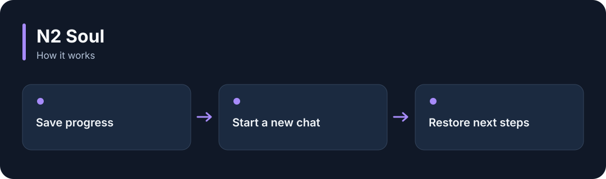

# N2 Soul

**Save what you worked on with an AI and what comes next, so a later conversation can pick it up.**

[](https://github.com/choihyunsus/soul/releases/tag/v9.2.1) [](https://github.com/choihyunsus/soul/blob/main/docs/reference.md) [](https://github.com/choihyunsus/soul/blob/main/LICENSE)

[한국어](README.ko.md)

<p align="center">
  
</p>

Save what you worked on with an AI and what comes next, so a later conversation can pick it up.

A story illustrating the feature, rather than a screenshot of the app.

<details>
<summary>View the workflow</summary>



</details>

## When to use it

Use it for work that spans several days, or when each new conversation needs the same background explained again.

Your AI app needs an MCP connection. MCP lets an AI app call external tools. Configure the app or agent to actually call the save and restore tools.

## Try it

Run `node --version` in a terminal and check for Node.js 22 or later. These commands create a fresh practice folder and install the GitHub release. Keep the example file and database in this folder.

```sh
mkdir soul-demo
cd soul-demo
npm init -y
npm install https://github.com/choihyunsus/soul/releases/download/v9.2.1/n2-soul-9.2.1.tgz
```

If installation reports a SQLite build error, you may need your platform’s C/C++ build tools. See the [installation reference](https://github.com/choihyunsus/soul/blob/main/docs/reference.md) for platform requirements.

Add this connection to your AI app’s MCP settings. Replace `C:/tools/soul` with the **absolute path** of your install folder. `N2_DATA_DIR` is a separate folder for memories. On macOS or Linux, use your own path such as `/home/me/tools/soul`.

```json
{
  "mcpServers": {
    "soul": {
      "command": "node",
      "args": [
        "C:/tools/soul/node_modules/n2-soul/dist/index.js"
      ],
      "env": {
        "N2_DATA_DIR": "C:/agent-memory/soul"
      }
    }
  }
}
```

Enable the connection, then ask your AI to do the following.

> Call Soul’s n2_kv_save with agent assistant, project demo, and summary “Review the installation guide next time”. After a successful save, call n2_kv_load with the same agent and project to read it back.

Look for a saved ID and the same next step in the loaded text. Check the actual tool results. Use the same identity and project in later conversations.

## Using it with Soul

Soul keeps progress summaries and handoffs. Mimir retrieves experience, Gumiho coordinates role-based work, and Loom handles dialogue and tool use. Connect the capabilities your app needs.

## Next steps and reference

The [full reference](https://github.com/choihyunsus/soul/blob/main/docs/reference.md) covers app integration, APIs, supported features, recovery and validation. The [release page](https://github.com/choihyunsus/soul/releases/tag/v9.2.1) contains the installable version and release notes.

A few terms used in the reference: **MCP** connects tools to an AI app, a **database** stores records, and the **host** is the app that connects and runs this module.

Review the [license](https://github.com/choihyunsus/soul/blob/main/LICENSE) for use and redistribution. Dependencies can have their own terms, including commercial-use conditions described in the reference.
